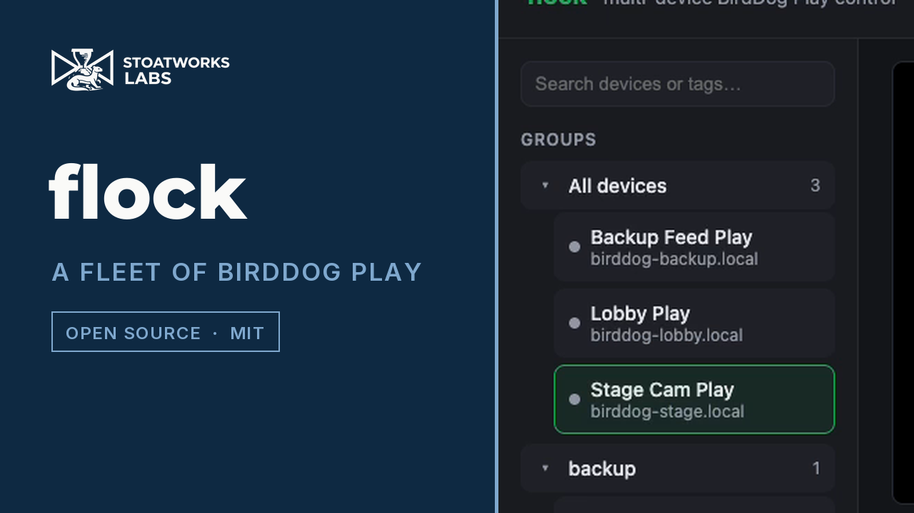
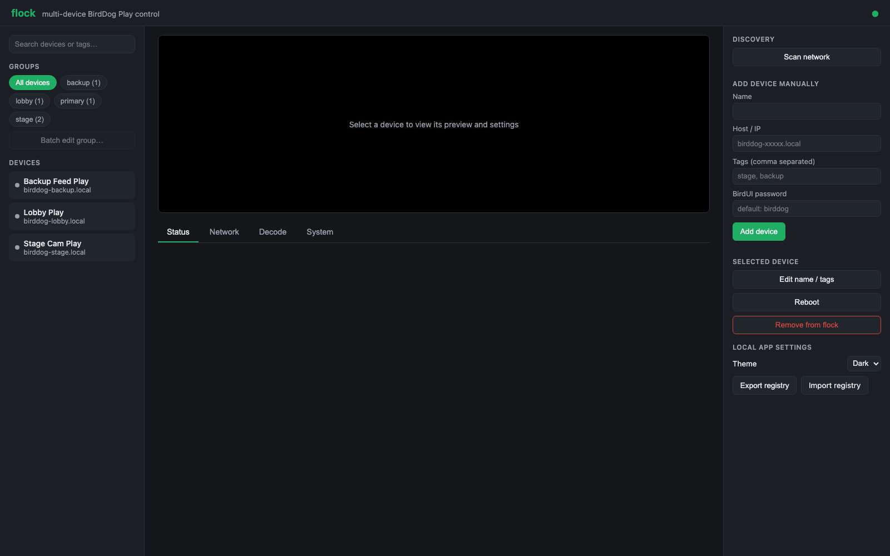
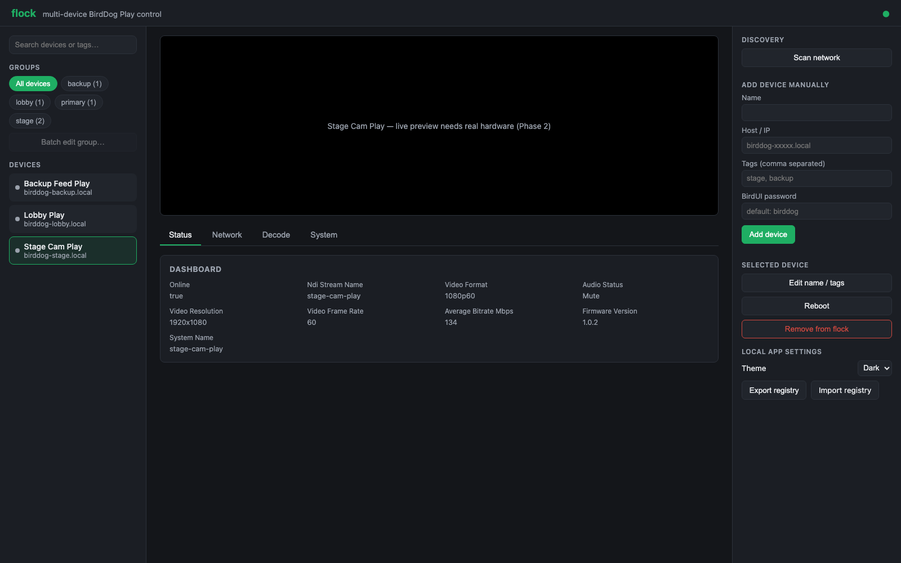
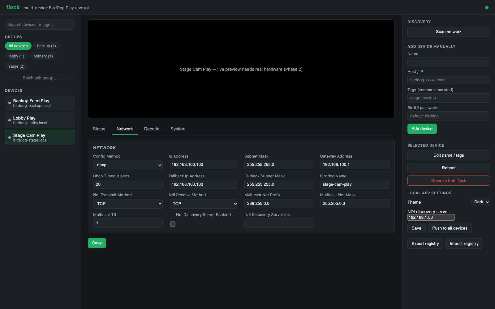
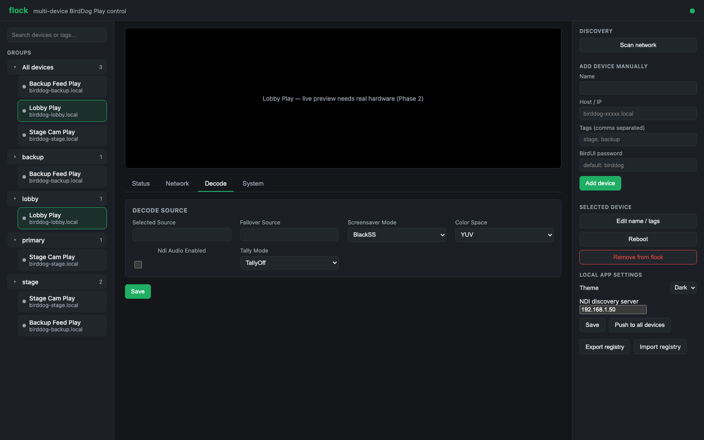
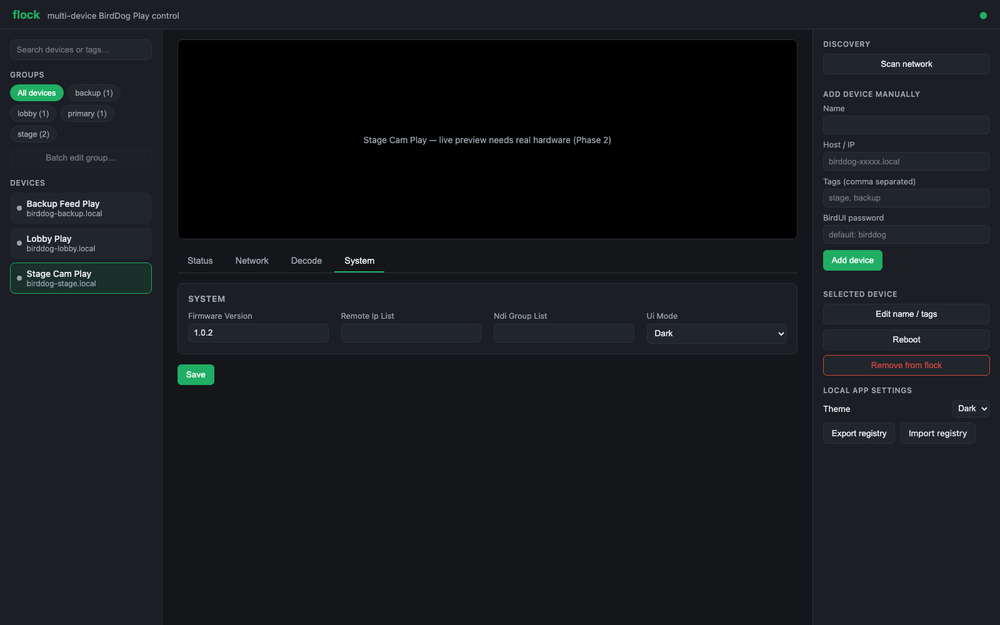
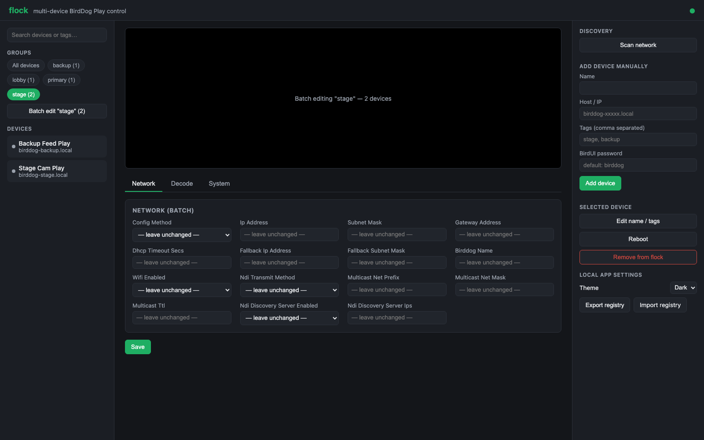
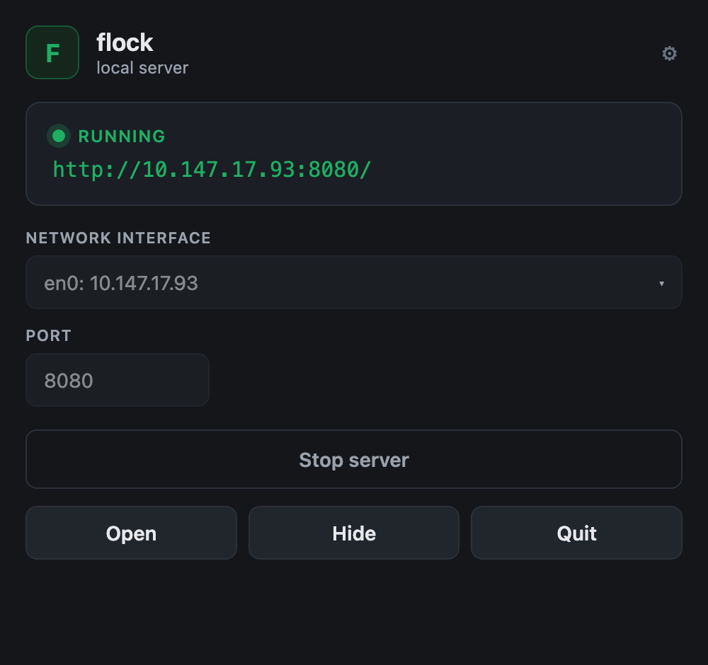
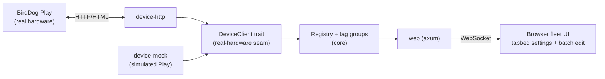

# flock

> **AI-assisted project.** This codebase was created with
> [Claude](https://claude.com/claude-code) (Anthropic), directed and
> reviewed by a human author. It's an early-stage hobby project. I've run
> it end to end against both a simulated BirdDog Play and a real one,
> including live reads and a real settings write (routing an actual NDI
> source to a physical unit's HDMI output). [Status](#status) below has
> what that covers and what's still unverified.

One web UI for managing any number of [BirdDog Play](https://birddog.tv/play-overview/)
NDI/SRT decoders. Each Play comes with its own [BirdUI](https://birddog.tv/birdui-overview/)
web interface, which is lovely for one unit and a lot of browser tabs for twenty. flock finds
Play units on the LAN (or you add them by hand), tags each into as many groups as you like,
shows every BirdUI setting for a device in one flat, tabbed view, and pushes a setting to a
whole group at once.

<!-- downloads:start -->

## Download

**[v0.2.6](https://github.com/stoatworks-labs/flock/releases/tag/v0.2.6)** — prebuilt for macOS, Windows and Linux. Pick your platform:

<details>
<summary><b>macOS</b> — Universal (Apple Silicon + Intel)</summary>

| Build | Download | Size |
| --- | --- | --- |
| Universal (Apple Silicon + Intel) · .dmg disk image (CLI) | [`flock-0.2.6-macos-universal-cli.dmg`](https://github.com/stoatworks-labs/flock/releases/download/v0.2.6/flock-0.2.6-macos-universal-cli.dmg) | 8.4 MB |
| .dmg disk image (app) | [`flock-0.2.6-macos-app.dmg`](https://github.com/stoatworks-labs/flock/releases/download/v0.2.6/flock-0.2.6-macos-app.dmg) | 16 MB |
| Universal (Apple Silicon + Intel) · .pkg installer (CLI) | [`flock-0.2.6-macos-universal-cli.pkg`](https://github.com/stoatworks-labs/flock/releases/download/v0.2.6/flock-0.2.6-macos-universal-cli.pkg) | 7.7 MB |
| .pkg installer (app) | [`flock-0.2.6-macos-app.pkg`](https://github.com/stoatworks-labs/flock/releases/download/v0.2.6/flock-0.2.6-macos-app.pkg) | 16 MB |
| Universal (Apple Silicon + Intel) · .tar.gz archive | [`flock-macos-universal.tar.gz`](https://github.com/stoatworks-labs/flock/releases/latest/download/flock-macos-universal.tar.gz) | 7.7 MB |

</details>

<details>
<summary><b>Windows</b> — x64, ARM64</summary>

| Build | Download | Size |
| --- | --- | --- |
| x64 · .exe installer | [`flock-0.2.6-windows-x86_64-setup.exe`](https://github.com/stoatworks-labs/flock/releases/download/v0.2.6/flock-0.2.6-windows-x86_64-setup.exe) | 2.7 MB |
| x64 · .exe installer | [`flock_0.2.6_x64-setup.exe`](https://github.com/stoatworks-labs/flock/releases/download/v0.2.6/flock_0.2.6_x64-setup.exe) | 4.9 MB |
| ARM64 · .exe installer | [`flock-0.2.6-windows-aarch64-setup.exe`](https://github.com/stoatworks-labs/flock/releases/download/v0.2.6/flock-0.2.6-windows-aarch64-setup.exe) | 2.4 MB |
| x64 · .msi installer | [`flock_0.2.6_x64_en-US.msi`](https://github.com/stoatworks-labs/flock/releases/download/v0.2.6/flock_0.2.6_x64_en-US.msi) | 7.5 MB |
| x64 · .zip archive | [`flock-windows-x86_64.zip`](https://github.com/stoatworks-labs/flock/releases/latest/download/flock-windows-x86_64.zip) | 3.4 MB |
| ARM64 · .zip archive | [`flock-windows-aarch64.zip`](https://github.com/stoatworks-labs/flock/releases/latest/download/flock-windows-aarch64.zip) | 3.2 MB |

</details>

<details>
<summary><b>Linux</b> — x64, ARM64</summary>

| Build | Download | Size |
| --- | --- | --- |
| x64 · .deb package (Debian/Ubuntu) | [`flock_0.2.6_amd64.deb`](https://github.com/stoatworks-labs/flock/releases/download/v0.2.6/flock_0.2.6_amd64.deb) | 9.5 MB |
| ARM64 · .deb package (Debian/Ubuntu) | [`flock_0.2.6_arm64.deb`](https://github.com/stoatworks-labs/flock/releases/download/v0.2.6/flock_0.2.6_arm64.deb) | 4.3 MB |
| x64 · .rpm package (Fedora/RHEL) | [`flock-0.2.6-1.x86_64.rpm`](https://github.com/stoatworks-labs/flock/releases/download/v0.2.6/flock-0.2.6-1.x86_64.rpm) | 4.4 MB |
| ARM64 · .rpm package (Fedora/RHEL) | [`flock-0.2.6-1.aarch64.rpm`](https://github.com/stoatworks-labs/flock/releases/download/v0.2.6/flock-0.2.6-1.aarch64.rpm) | 4.5 MB |
| x64 · AppImage | [`flock_0.2.6_amd64.AppImage`](https://github.com/stoatworks-labs/flock/releases/download/v0.2.6/flock_0.2.6_amd64.AppImage) | 88 MB |
| x64 · .tar.gz archive | [`flock-linux-x86_64.tar.gz`](https://github.com/stoatworks-labs/flock/releases/latest/download/flock-linux-x86_64.tar.gz) | 4.1 MB |
| ARM64 · .tar.gz archive | [`flock-linux-aarch64.tar.gz`](https://github.com/stoatworks-labs/flock/releases/latest/download/flock-linux-aarch64.tar.gz) | 4.2 MB |

</details>

All builds, checksums and release notes: [github.com/stoatworks-labs/flock/releases](https://github.com/stoatworks-labs/flock/releases).

macOS builds are signed and notarised and open normally. The Windows builds are unsigned, so SmartScreen warns once — see [Windows SmartScreen & Defender Firewall](#windows-smartscreen--defender-firewall) for the one-time click-through.

<!-- downloads:end -->

## Try the UI

**<https://flock-demo.stoatworks-labs.com>** is flock's own web UI, clickable, in your
browser. It replays responses recorded from flock running against its three seeded
`device-mock` devices, so what you see is output flock actually produced.

Nothing there is live and nothing you change is saved: flock talks to PLAY units
over the LAN, and a hosted page has no devices to reach. To control real
hardware, run it yourself (see [Quick start](#quick-start)). How the demo is
built, and the rules it follows to stay honest, are in [demo/README.md](demo/README.md).

## Screenshots

*Screenshots of flock running locally against the three seeded `device-mock` devices
(see [Status](#status)). They're not mockups.*

**Overview**: a nested group tree on the left (a device can sit in more than one group,
and shows up under each), preview and settings in the centre, discovery/add/local
settings on the right:

[](https://www.youtube.com/watch?v=cMsg6hkjjN0)

*A 45-second tour of the app against its three seeded `device-mock` devices, the same
simulated fleet the hosted demo records from. No PLAY hardware was involved.*



The **Status** tab, the per-device dashboard:



The **Network** tab has IP config, NDI transmit/receive preferred method, multicast and
discovery server settings, all in one flat panel:



The **Decode** tab has NDI or SRT source selection (toggled per device), failover,
screensaver, colour space, NDI audio and tally (Play is decode-only, so there's no Encode
tab). SRT support is new, so see [Status](#status) for what's confirmed against real
hardware and what's still a best guess:



The **System** tab has the firmware version and Access Manager lists:



**Batch edit**: groups are a nested tree in the left panel. Click a group's header to
batch-edit every member at once, or expand it to drill into an individual device. Every
field starts blank/"leave unchanged", and only the fields you actually fill in are sent,
merged into each member device's own current settings rather than overwriting the whole
group with a shared template:



## What it does

- **Device registry**: any number of BirdDog Play devices, each taggable
  into multiple groups (a device isn't locked to one group).
- **Discovery**: an active LAN subnet probe (which is how a real Play has to be
  found, since it doesn't advertise itself over mDNS at all), manual add-by-host
  as a fallback that always works, and a *separate*, centralised NDI source list
  (mDNS) that suggests values in the Decode tab. flock discovers NDI sources once,
  itself, instead of each Play searching on its own, which is the same
  control-plane-only model proper NDI routers (BirdDog's own Keyboard, Vizrt's NDI
  Router) use. See [docs/architecture.md](docs/architecture.md).
- **Full BirdUI parity for Play** (decode-only, so no Encode tab): Status
  (Dashboard), Network, Decode (NDI source + failover, or SRT: caller/
  listener, stream name, IP/port, latency, encryption) and System
  (password/firmware/Access Manager/UI mode), with every field right there
  in its tab and nothing hiding behind a submenu.
- **Nested groups, one click to batch-edit**: groups are a vertical tree in
  the left panel (a device can sit in more than one, appearing under each).
  Click a group's header to apply a Network/Decode/System change to every
  member at once, or expand it to drill into an individual device. Blank
  fields mean "leave unchanged": a batch save merges into each device's own
  current settings rather than clobbering the whole group with one shared
  template.
- **NDI Discovery Server, fleet-wide**: set it once in Local App Settings and
  push it to every registered Play's own Network settings in one click
  (flock can't query a Discovery Server itself, as there's no public protocol
  spec, but every Play can, so this sets them up to).
- **Live updates**: a WebSocket pushes registry/status changes to every open
  browser tab.
- **Runs in Docker**: `docker compose up` (see the networking note below).

## Status

**Phase 2 (current): validated against both a simulated and a real BirdDog
PLAY.** `crates/device-mock` stands in for hardware for quick iteration and
demos; `crates/device-http` is a real client, confirmed against an actual PLAY
unit (firmware 1.0.18). The "Confirmed against real hardware" section of
[docs/architecture.md](docs/architecture.md) spells out what that means, and
its known limitations.

Working:
- Cargo workspace (`core`/`discovery`/`device-mock`/`device-http`/`web`/
  `flock`), `cargo build`/`clippy`/`test` all clean, including offline unit
  tests for the real HTML scraper against fixtures captured from actual
  hardware
- Three-pane UI: device list + tag-derived groups on the left, preview +
  tabbed settings in the centre, discovery/add/remove/local settings on the
  right
- Every settings tab round-trips against the mock device, single-device or
  batched across a whole group
- Reads (`status`/`network_settings`/`decode_settings`) **and** a real
  settings write, both verified live against physical hardware: I routed an
  actual NDI source to a real Play's HDMI output through flock's own API,
  read the change back, and switched it twice more. Along the way I found (by
  testing, not guessing) that the decode-source picker needs a separate JSON
  API on port 8080 and a specific button field without which the server
  silently ignores the request. See [docs/architecture.md](docs/architecture.md)
- Subnet-probe + mDNS discovery scan + manual add/edit/remove
- `docker-compose.yml` with host networking (needed for the subnet probe and
  mDNS alike)
- Device passwords are encrypted at rest (AES-256-GCM, auto-generated key
  file). `registry.json` itself never holds a plaintext password, and an
  older plaintext registry.json migrates transparently on its next save.
  See [docs/architecture.md](docs/architecture.md#credentials-are-encrypted-at-rest-transparently)
- SRT decode support (the real Play I test on gained this from a firmware
  update halfway through development): switching a device between NDI and SRT
  source mode is confirmed working live, including the real HTML field names.
  Applying a manually typed SRT connection is a separate mechanism (a JSON API
  on port 8080, reverse engineered from BirdUI's own JS). It's implemented, but
  it was unreliable (it timed out) in live testing, so it's non-fatal on
  purpose and can never block the rest of a decode save. See
  [docs/architecture.md](docs/architecture.md#srt-decode-support---confirmed-live-apply-mechanism-partially-unreliable)
- Optional auth for flock itself. It's off by default (the same trusted-LAN
  behaviour as before), but setting `admin_password` in `config/flock.toml`
  puts the whole UI/API behind a single shared login, with brute-force
  lockout on the login endpoint. See
  [docs/architecture.md](docs/architecture.md#flocks-own-auth-is-optional-off-by-default)
- **Live preview for SRT decode sources**, properly live rather than a
  snapshot (in caller/rendezvous mode). flock dials the same `srt://` source
  the device decodes from and streams it into the browser through ffmpeg.
  Along the way I found that modern Chrome doesn't reliably render
  `multipart/x-mixed-replace` through a plain `` any more, so the
  frontend parses the stream itself and swaps in a fresh frame per `blob:`
  URL instead. It needs an `ffmpeg` with SRT input support on `PATH` (most
  default packages haven't got it; see below). NDI preview stays a
  placeholder on purpose, because there's no open decoder without the
  proprietary NDI SDK. See [docs/architecture.md](docs/architecture.md#live-srt-preview)

Not yet done:
- Live NDI preview (no open decoder without the proprietary NDI SDK; see above)
- Applying a manually entered SRT source (see above): the device-side
  mechanism hasn't behaved reliably in testing yet

## Quick start

```bash
cargo run -p flock
```

Then open `http://localhost:8080`. On first run with an empty registry it
seeds three demo devices, so there's something to look at straight away.
Everything works without it, but for the live SRT preview you need `ffmpeg`
on `PATH`, and specifically a build with SRT input support, which most
default packages (plain Homebrew `ffmpeg` on macOS included) haven't got; see
[docs/architecture.md](docs/architecture.md#live-srt-preview).

### Docker

```bash
docker compose up --build
```

This uses `network_mode: host` so both discovery mechanisms (the subnet probe
and mDNS) can reach the LAN from inside the container. See
[docs/architecture.md](docs/architecture.md#docker--networking) for the
trade-off, and the bridge-networking alternative if you'd rather keep
container isolation and rely on manual add only. The image installs `ffmpeg`
for the live SRT preview, but whether Debian's package has SRT input support
is unconfirmed, so check with
`docker compose exec flock ffmpeg -protocols | grep srt` if the preview
isn't working.

### Desktop app

Rather not touch the terminal? A small menu-bar app lets you pick the network
interface and port, start and stop the server, and open the web UI. The `flock`
server is bundled inside, so it's one download with nothing to install or wire up.
Grab the `.dmg` from [Releases](https://github.com/stoatworks-labs/flock/releases),
or see [launcher/](launcher/) to build it. It doesn't bundle `ffmpeg`, so the
live SRT preview needs one on the host machine's `PATH` separately.

<p align="center"></p>

## Architecture



See [docs/architecture.md](docs/architecture.md) for the crate layout, the
`DeviceClient` trait that keeps the real-hardware integration to one seam,
and the full list of what's confirmed against real hardware and what's still
unconfirmed or unimplemented.

## Windows SmartScreen & Defender Firewall

macOS builds are **Developer ID-signed and notarised by Apple**, so they open
normally, with no Gatekeeper warning and no quarantine step. The Windows
binaries **aren't** code-signed, so Windows still warns you the first time.

- **Windows**: SmartScreen shows *"Windows protected your PC"* →
  **More info** → **Run anyway**.
- **Windows Defender Firewall**: first launch pops up *"Allow flock to communicate on
  these networks"*. Tick **Private** (and **Domain** on a managed network), because flock
  needs it to serve the web UI and find BirdDog decoders by broadcast discovery on your LAN.
  Deny it and discovery will come back empty and the UI won't be reachable from another
  machine.
- **Linux**: no signing gate.

Per-artifact steps, self-signing, checksum verification and the Defender Firewall reset
procedure: **[docs/UNSIGNED.md](docs/UNSIGNED.md)**.

## Roadmap / TODO

Full plan in [docs/roadmap.md](docs/roadmap.md). Next up:

- [ ] **Subscribe to the real device's live status WebSocket** instead of polling `/dashboard`.
- [ ] **Real live video preview**: an actual NDI/SRT frame grab (currently a placeholder).

## Control it from Companion

[**companion-module-flock**](https://github.com/stoatworks-labs/companion-module-flock) is a [Bitfocus Companion](https://bitfocus.io/companion) connection module for this app.

It changes what any decoder is playing, **takes a source to every decoder carrying
a tag**, reboots them and manages fleet membership, with a monitor tile per decoder.

Its group feedback only lights when *every* member has landed on the source, not
when most of them have, and a decoder that stops answering shows as offline rather
than holding its last reading.

It isn't in the official Companion module store, so install it through
**Settings → Developer modules path**.

## Trademarks and third-party licences

**NDI® is a registered trademark of Vizrt NDI AB.** See <https://ndi.video>.
This project is not affiliated with or endorsed by Vizrt.

The NDI runtime is obtained separately under Vizrt's own terms and is not
redistributed here. NDI Tools are not redistributed either — get them from
<https://ndi.video/tools>.

H.264, H.265 and AAC are separately licensable formats. The NDI SDK grant does
not cover them, and the obligation sits with whoever ships a product using them.

<!-- attributions:start -->
This project is built on other people's work — see [ATTRIBUTIONS.md](ATTRIBUTIONS.md).
<!-- attributions:end -->
